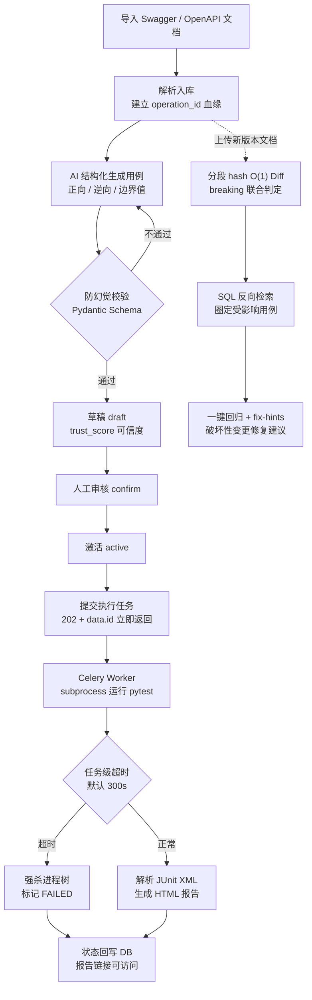
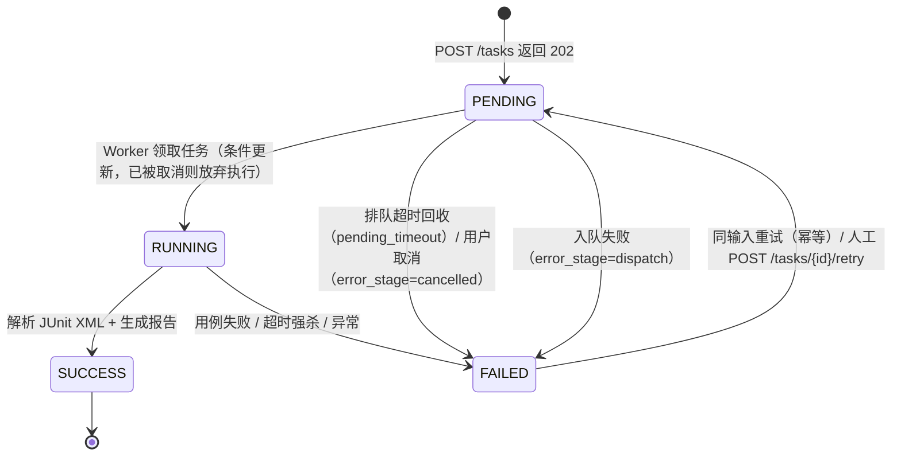

<!-- 本项目编码格式：UTF-8（无 BOM）。 -->
<div align="center">
  <h1>智能化接口测试效能平台 · 后端</h1>

  <p>
    <a href="https://github.com/Testamentt/ApiTestPlatform_Backend/actions/workflows/ci.yml"></a>
    
    
    
    
    
    
    
    
  </p>

  <p>
    FastAPI + Celery + AI 的接口测试平台后端：导入 OpenAPI 文档，生成用例草稿，人工审核后在独立进程中执行并输出 HTML 报告。
  </p>
</div>

> 定位：后端项目入口，覆盖项目说明、快速开始、目录结构、常见问题与文档索引。
> 事实源：`app/main.py`、`app/api/v1/`、`app/services/`、`app/core/config.py`、`Jenkinsfile` ｜ 最后核对：2026-11-12

## 1. 项目描述

基于 FastAPI + Celery + AI 的接口测试平台后端，覆盖「用例智能生成 → 变更影响圈定 → 异步执行 → 报告输出」四个环节。配套 Vue 3 前端独立仓库：[ApiTestPlatform_Frontend](https://github.com/Testamentt/ApiTestPlatform_Frontend)。

## 2. 项目预览：可运行入口

下面每个入口都能在本地跑起来看，验证方式就是入口本身：

| 入口 | 地址 / 位置 | 看到什么 |
| :--- | :--- | :--- |
| Swagger UI | `http://127.0.0.1:8000/docs` | 全部端点、请求示例与 Authorize 鉴权按钮（默认 token `testplatform-dev-token`）；`/health` 免鉴权 |
| 前端四页 | `http://127.0.0.1:5173`（dev）或 `http://127.0.0.1:8080`（`--profile frontend`） | 仪表盘 / 用例管理 / 任务执行 / AI 生成，见前端仓库 |
| HTML 报告 | 任务详情 → 报告；端点 `GET /api/v1/tasks/{id}/report` | 单文件 HTML：总数 / 通过 / 失败汇总 + 逐用例 `case_id`、状态与失败信息（字段转义防 XSS） |
| Allure 报告页 | Jenkins 构建页侧栏「Allure Report」 | 用例趋势、失败分类；需 Jenkins 侧配好 Allure 全局工具（见 §8） |
| CI 报告制品 | GitHub Actions run → Artifacts `backend-test-report` | `reports/` 全量：JUnit XML、coverage XML + HTML、Allure 结果与 HTML |

报告与 Swagger 的读接口都要 Bearer token。Allure 页是 Jenkins 侧能力：工具链未配时流水线只打印警告并继续，测试门禁不受影响。

## 3. 核心能力

| 问题 | 做法 | 观测结果 |
| :--- | :--- | :--- |
| 用例编写重复耗时 | AI 解析 OpenAPI 结构化生成，人工审核兜底 | 单接口编写耗时降低约 80% |
| 变更后回归范围凭经验 | 接口血缘 + 分段哈希比对自动圈定 | 影响圈定 <10 s |
| 同步执行阻塞 Web | Celery 异步解耦 + 任务级超时兜底 | Web 响应稳定 <50 ms |
| 质量缺少度量门禁 | GitHub Actions + Jenkins 双通道产出 JUnit / coverage / Allure 标准制品 | 全项目覆盖率实测见最新 CI（2026-11-13 全量 497 用例），门槛 60/80；计数与覆盖率以最新 CI 运行为准 |

### AI 用例智能生成

用例生成链路为「OpenAPI 解析 → 结构化 Prompt → LLM 生成 → 人工审核」：LLM 只产草稿，人工确认后才转为 active。

- 自研文档解析器：不依赖第三方 SDK，带容错与递归深度限制。文档超过上限（约 2 MB）直接拒绝解析；实测 320 paths / 338 operations 入库 0 warning。
- 结构化提示词：正向 / 逆向 / 边界值三类用例模板，prompt 层强约束每条用例至少 1 条断言；边界规则外置 `prompts/v1/boundary_rules.md`，调整规则不改代码。
- 三层防幻觉护栏：LLM 输出先过 Pydantic Schema 严格校验，状态恒为 `draft`，不允许自动激活；`operation_id` 由服务端注入，`trust_score` 记录血缘可信度。
- 成本审计封装：`llm_client` 是唯一封装，连接 / 读超时 5 s / 60 s，瞬时异常重试上限 3 次（指数退避），输入长度预检 5 万字符；每次生成落 token 与成本审计记录。

LLM 服务不可用或响应超时，任务落 FAILED 并保留进度快照；同输入可重试，不阻塞其他链路。生成任务的总时长预算由 `llm.task_timeout_seconds` 控制（默认 600 s），由任务内自检：`--pool=solo` 下 Celery 的 soft/hard time_limit 会被静默关闭。

### 接口变更影响圈定

影响分析是纯规则链路（不调用 LLM、零成本、无幻觉）：文档比对 → 血缘反查 → 一键回归。

- 接口血缘标记：用例与接口定义通过 `operation_id` 建立可反查关联，是影响分析的基础。
- 分段哈希比对：新版 Swagger 与历史快照按 operation 分段 sha256，O(1) 定位变更点；breaking 六类联合判定破坏性等级（契约缺失保守判破坏、required 收紧、响应码删减、type 变化、枚举删减、字段删除）。
- 影响反向检索：SQL 反查受影响用例，附孤儿用例迁移清单。
- 一键回归与修复建议：圈定结果直接发起回归，破坏性变更给出 AI 修复建议（fix-hints）。

新版文档格式异常或超过解析上限时直接拒绝，已入库的上一版快照与存量用例不受影响，不会产生半更新状态。

### 异步执行引擎

Web 服务与执行引擎进程隔离：同步调用 pytest 曾让超时率达 30% 以上；任务状态以 DB 为单一事实源，Worker 重启后任务不丢。

- 任务队列解耦：Celery + Redis 削峰。`POST /tasks` 立即返回 202 + `{code, message, data}`，任务 id 在 `data.id`（不是 `task_id`）；前端轮询至终态，Web 进程零阻塞。
- 超时强杀：任务级超时默认 300 s（接口可配），以 subprocess `communicate(timeout)` 为准；Windows 用 `taskkill /T`、POSIX 用 `killpg` 杀整棵树。
- 僵尸任务回收：`scan_stale_tasks` 以 DB 为权威状态，回收 `running` 超时与 `pending` 排队孤儿；周期由 **Celery Beat** 触发（`celery.stale_scan_interval` 默认 60 s，置 0 关闭），Worker 启动时再补扫一次。`pending` 判定按队列位置放宽（基础 `celery.pending_timeout` 600 s + 前序任务超时预算），solo 串行下正常排队不会被误杀；`pending` 任务可取消（`POST /tasks/{id}/cancel`），失败任务可人工重试。Beat 是独立进程（compose 的 `beat` 服务、`scripts\start_beat.bat`），只发调度消息不执行任务，与 Worker 分开重启。
- 执行器可切换：`execution.executor=local` 由平台起 pytest 子进程（默认，行为与拆分前一致），`=jenkins` 改为投递 Jenkins 构建并回读 JUnit。编排层只依赖 `app/services/executors/` 的协议与 `get_executor` 工厂，状态机与事务边界不感知报告来自本地文件还是 Jenkins 制品；两种实现对外只回「汇总 + 逐用例 + `build_url`」。
- Jenkins 边界：`app/utils/jenkins_client.py` 是唯一 HTTP 封装（CSRF crumb + 会话；`buildWithParameters` 传 `TASK_ID` / `CASE_IDS` / `BASE_URL` → 队列 → 轮询 → 下载制品），超时全部来自 `jenkins.*`，API token 只从 `.env` 的变量名读取，不拼 URL、不入日志。设计上只做轮询回读、不做入站回调：平台不必对外开放端口，凭据与签名面收敛；失败按 `JENKINS_NOT_CONFIGURED` / `JENKINS_UNAVAILABLE` / `JENKINS_TRIGGER_FAILED` / `JENKINS_HTTP_ERROR` / `JENKINS_BUILD_CANCELLED` / `JENKINS_TIMEOUT` / `JENKINS_NO_REPORT` / `JENKINS_REPORT_INVALID` 分级落 `error_stage`。
- 幂等与重试：`run_id` Lookup-Create 去重，成功任务复用结果，失败任务同输入可重试，不产生重复执行记录；并发撞 `UNIQUE(run_id)` 时查回已存在的记录返回，不抛 500。
- 可视化测试报告：自包含 HTML 单文件，字段转义防 XSS，按任务隔离目录落盘，经带鉴权的 `GET /api/v1/tasks/{id}/report` 读取（无鉴权的 `/static` 静态面已摘除，防按 id 枚举），测试文件不外泄。

Worker 异常退出时任务状态以 DB 为准，重启后由 `scan_stale_tasks` 回收僵尸任务（不重启时由 Beat 周期回收），任务不丢、不重复执行。

### 质量门禁与工程化

CI 的每个 job 都设有 fail-under 阈值，不达标即拦截合入；测试结果同时是「页面」和「制品」，不是只躺在控制台日志里。

- 双通道门禁：GitHub Actions 三个 job（`test-fast`：ruff + pytest + 覆盖率；`test-slow`：e2e 冒烟；`docker-build`：镜像构建验证）+ `Jenkinsfile` 四阶段（准备环境 → 静态检查 + 文档门禁 → 测试与覆盖率 → 慢测试 / 镜像构建，后两项各占一个可选 stage，由 `RUN_SLOW` / `RUN_DOCKER` 控制），参数为 `PYTHON_BIN` / `RUN_SLOW` / `RUN_DOCKER`。两处阈值同源：全局覆盖率 60%，`services` + `utils` 核心模块 80%。
- 标准报告产物：一次 pytest 同时产 `reports/junit.xml`（逐用例）、`reports/coverage.xml` + `reports/htmlcov`（覆盖率趋势与行级明细）、`reports/allure-results`（Allure 测试结果）。这三种格式都是流水线可直接消费的交换格式，报告因此有「页面」与「制品」两种读法。
- 发布与归档：Actions 侧用 `EnricoMi/publish-unit-test-result-action` 把逐用例结果发到 Checks / PR 注释，`upload-artifact` 归档 `reports/`（保留 14 天）；Jenkins 侧 `junit` + `recordCoverage` + `publishHTML`（coverage HTML）+ `allure` + `archiveArtifacts`（`reports/**`）。构建失败同样挂报告，构建页可直接点开红用例。
- 报告层不判门禁：发布步骤带 `hashFiles` 守卫与 `continue-on-error`，Jenkins 的 `recordCoverage` 包 `fileExists`、Allure 步骤包 `try/catch`。收集期崩溃时不产 `junit.xml`，这些守卫让「报告发布失败」不会伪装成「测试失败」，也不把已通过的测试判红。
- 门禁实测：`pytest -q` 497 passed / 4 deselected（`slow` e2e 被默认 `addopts` 排除，`pytest -m slow` 单独跑），全项目覆盖率 93.63%；`ruff check` / `ruff format --check` 与 `scripts/doc_check.py` 全绿（2026-11-13 本地全量复跑）。
- 真实 Jenkins 验证：在与 `Jenkinsfile` 等价的 Windows job 上跑完 build #7 / #8（SUCCESS，当时 368 passed / 4 deselected；此后用例数增加，最新本地全量为 410），`junit` 收 368 条用例，coverage 趋势页与 `Allure Report` 页均返回 200，`allure-results` / `allure-report` / `junit.xml` / `coverage.xml` / `htmlcov` 全部进构建归档。这是「在真实 Jenkins 上完成过一次完整验证」，不等于生产集成；仓库内 `Jenkinsfile` 走 `sh` 与 `.venv/bin`，需要 Linux agent，跨机器复现还取决于 Jenkins 插件与 Allure 工具链配置。
- 接口鉴权防护：HTTPBearer 统一依赖注入，无凭证返回 401、凭证错误返回 403；`/health` 免鉴权作探针，`/docs` 在生产环境可一键关闭。
- 全链路追踪：`X-Request-ID` 中间件让 Web → Celery → LLM 的日志贯穿同一请求 id，故障可按 id 一次性检索定位。
- AI 治理红线：LLM 调用必须走唯一封装，输出必过 Schema 校验，生成结果恒为 `draft`，密钥只放 `.env`，测试必 mock LLM。
- 工程红线：禁止吞异常；外部调用必设 timeout（值来自 config）；SQLite 强制 WAL 模式。

## 4. 系统流程

### 主流程（活动图）



### 任务状态机（状态图）



## 5. 技术栈

| 层次 | 技术 | 作用 |
| :--- | :--- | :--- |
| Web 服务层 | Python 3.12、FastAPI、SQLAlchemy 2.0、Pydantic Settings | REST API、六表数据访问与类型安全配置 |
| 数据存储 | SQLite（WAL + busy_timeout + foreign_keys）、Redis | 业务数据单一事实源；Celery Broker 与状态缓存 |
| 异步执行层 | Celery 5、subprocess + pytest、执行器抽象（local / jenkins） | 任务解耦、进程隔离执行、超时强杀、报告回读 |
| AI 能力层 | DeepSeek API（OpenAI 兼容）、自研 OpenAPI 3.0 解析器、结构化 Prompt | 用例智能生成、三层防幻觉护栏与成本审计 |
| 质量与交付 | pytest、ruff、JUnit / coverage / Allure 报告、GitHub Actions、Jenkins、Docker Compose | 测试门禁、静态检查、双通道 CI、报告发布与归档、容器化 |
| 配套前端 | Vue 3、Element Plus、Pinia、Vite、Vitest | 四页管理界面与 64 个单测（独立仓库，见文首链接） |

## 6. 快速开始

### 环境要求

| 组件 | 版本 | 说明 |
| :--- | :--- | :--- |
| Python | 3.12+ | 后端运行环境 |
| Redis | 任意可用版本 | 本地 127.0.0.1:6379，需设置 requirepass |
| Docker Desktop | 可选 | 一键起后端全栈；前端镜像另需 `--profile frontend` |
| Jenkins | 可选（2.580.2 实测） | 仅 `execution.executor=jenkins` 需要：装 JUnit / Coverage / HTML Publisher / Allure 插件，agent 需 Python 3.12+ |
| Node.js + pnpm | 可选（Node ≥ 20、pnpm 10） | 仅本地跑前端或构建前端镜像时需要 |
| LLM API Key | 可选 | 仅 AI 用例生成需要，配置在 `.env` 的 `DEEPSEEK_API_KEY`（任意 OpenAI 兼容端点均可：`TESTPLATFORM_LLM_BASE_URL` / `TESTPLATFORM_LLM_MODEL` 覆盖，如 CommandCode） |

### 常见命令

| 命令 | 作用 |
| :--- | :--- |
| `pytest -q` | 后端测试门禁（单元 / 接口 / 任务），2026-11-13 实测 497 passed / 4 deselected |
| `pytest -m slow` | 慢测试 / e2e 冒烟（CI 单独 job，不随默认门禁） |
| `pytest -m slow tests/e2e/test_real_full_chain.py -s` | 真实全链路 e2e：真 LLM（配置里的 OpenAI 兼容端点）+ 真 pytest 子进程 + 真 HTTP；进程级用 `REAL_E2E_PROCESS=1`（见下） |
| `pytest --junitxml=reports/junit.xml --cov=app --cov-report=xml:reports/coverage.xml --cov-report=html:reports/htmlcov` | 本地复现 CI 报告产物（先建 `reports/`；JUnit + coverage XML/HTML）。Allure 结果由 `--alluredir=reports/allure-results --clean-alluredir` 产出，该参数由 `dev` extras 中的 `allure-pytest` 提供（`pip install -e ".[dev]"` 已包含，本地可完整复现 CI/Jenkins 的同一套产物） |
| `python scripts/jenkins_smoke.py` | Jenkins 集成冒烟：触发→轮询→回读 JUnit，不依赖 Celery/Redis。**需先起 Jenkins 并配好** `jenkins.*` + `JENKINS_API_TOKEN`；这是验证入口，不代表开箱即通 |
| `ruff check app tests scripts` | 静态检查（CI 另跑 `ruff format --check .`） |
| `python scripts/doc_check.py` | 文档结构门禁：相对链接、代码围栏语言、H2 编号连续；CI 与 Jenkins 均已接入 |
| `python scripts/fix_report_links.py [--dry-run]` | 旧库 report_link 迁移：`/static/{id}/report.html` → `/api/v1/tasks/{id}/report`（幂等） |
| `scripts\start_all.bat` | 一键拉起 Web + Worker + Beat（三个窗口） |
| `scripts\start_beat.bat` | 只起 Celery Beat（周期僵尸回收；与 Worker 分开重启） |
| `scripts\reset_db.bat` | 重置开发库（schema 漂移时） |
| `python scripts/mock_target.py` | 启动本地被测 mock 服务（:9999） |
| `docker compose up --build` | 容器起后端全栈（api + worker + beat + redis + mock，五服务，全离线） |
| `docker compose --profile frontend up --build` | 追加前端 `web` 服务（nginx，六服务）；需把前端仓 clone 到同级 `../frontend` |
| `docker compose --profile frontend down` | 连 profile 服务一起下掉（`down` 默认不清理 profile 服务） |

### 真实全链路 e2e（不 mock LLM / 不 mock HTTP 客户端）

`tests/e2e/test_real_full_chain.py` 与默认 e2e（`FakeLlmClient` + fake `run_cmd`）相反：LLM、pytest 子进程、HTTP 请求全部真实，默认门禁排除（标 `slow`），不会烧 API 额度。

| 用例 | 需要真实 key | 覆盖 |
| :--- | :--- | :--- |
| `test_real_execution_to_report_without_llm` | 否 | 真 pytest 子进程 + 真 HTTP 请求 + 真 HTML 报告 |
| `test_real_ai_generate_then_execute` | 是 | 真 DeepSeek 生成（usage/cost 审计）→ 审核 → 真执行 → 报告 |
| `test_real_full_chain_process_level` | 是（另需 `REAL_E2E_PROCESS=1`） | 真 uvicorn + 真 Celery worker（真 Redis broker）跨进程全链路 |

```bash
# 前置：backend/.env 配真实 DEEPSEEK_API_KEY（缺失时 LLM 用例自动 skip，不误报失败）
pytest -m slow tests/e2e/test_real_full_chain.py -s

# 进程级（本机需 Redis；会临时拉起 uvicorn + worker，结束后按进程树回收）
$env:REAL_E2E_PROCESS=1; pytest -m slow tests/e2e/test_real_full_chain.py -s
```

> 被测服务默认起本地 `scripts/mock_target.py`（真 socket，不是 HTTP 客户端替身）；联调真系统时设 `REAL_E2E_BASE_URL` 指向它，测试代码不变。

### 后端启动

```bash
# 1. 安装依赖
python -m venv .venv
.venv\Scripts\activate          # Windows；Linux/macOS 用 source .venv/bin/activate
pip install -e ".[dev]"

# 2. 初始化配置
copy config\settings.example.yaml config\settings.yaml
copy .env.example .env          # 编辑 .env：填入 Redis 密码；AI 生成功能再填 DEEPSEEK_API_KEY

# 3. 启动本地被测 mock 服务（另开终端，保持运行）；.env.example 的 execution.base_url 即指向它
python scripts/mock_target.py   # 监听 127.0.0.1:9999

# 4. 启动 Web 服务
uvicorn app.main:app --port 8000

# 5. 启动 Celery Worker（Windows 必须 --pool=solo）
celery -A app.celery_app:celery_app worker --pool=solo

# 6. 启动 Celery Beat（僵尸回收 scan_stale_tasks 的周期调度，周期=celery.stale_scan_interval，默认 60 s；不跑则只剩 Worker 启动时那一次扫描）
celery -A app.celery_app:celery_app beat

# 步骤 4/5/6 也可用 scripts\start_all.bat 一键拉起（三个窗口：Web + Worker + Beat）
```

启动后验证：

- Swagger UI 界面：`http://127.0.0.1:8000/docs`（右上角 Authorize，token 默认 `testplatform-dev-token`）
- 健康探针：`http://127.0.0.1:8000/health`

免装环境时可用 Docker 起后端全栈（替代步骤 1~6，内置 mock 服务，全离线可复现）：

```bash
docker compose up --build
```

启动后：后端 API `http://127.0.0.1:8000/docs`，容器内已内置 mock 服务，无需另起被测系统。编排里 `beat` 是独立服务（调度表来自 `app/celery_app.py` 的 `beat_schedule`，间隔取 `celery.stale_scan_interval`），`api` / `worker` / `beat` 共用同一个 SQLite 卷，Worker 固定 `--pool=solo --concurrency=1` 单写者。

> **AI 生成需要宿主提供 API key**：容器不继承宿主环境变量，compose 只透传显式声明的几项。运行前在宿主机设好 key（或写进 `.env`，compose 会自动读取同名变量）：
>
> ```bash
> # PowerShell：$env:DEEPSEEK_API_KEY = "sk-..."
> # bash：export DEEPSEEK_API_KEY=sk-...
> docker compose up --build
> ```
>
> 不配 key 时**执行链路照常可用**（用例 CRUD / 执行 / 报告都不依赖 LLM），只有 `POST /generate` 会失败——Worker 里报 `openai.OpenAIError: Missing credentials`，任务落 `failed(internal)`。这是显式失败而非静默跳过。换模型或代理端点改 `TESTPLATFORM_LLM_BASE_URL` / `TESTPLATFORM_LLM_MODEL` 两个同名宿主变量即可，密钥变量名由 `TESTPLATFORM_LLM_API_KEY_ENV` 指定（默认 `DEEPSEEK_API_KEY`）。

> **升级后必须迁移库**：库在 named volume 里，`docker compose up --build` 重建镜像**不会**改已有库的表结构。模型改过列之后不迁移，`GET /cases` 会直接 500（`no such column` / `NOT NULL constraint failed`）。
>
> ```bash
> docker compose up -d api
> docker compose exec api python scripts/migrate_db.py --dry-run   # 先看要执行什么
> docker compose exec api python scripts/migrate_db.py             # 幂等补列/删阻断列
> docker compose restart api worker beat
> ```
>
> 不想保留库内数据时可用 `docker compose down -v && docker compose up --build`——`-v` 会连 `dbdata` 与 `reports` 两个 volume 一起删，用例、执行记录与报告全部丢失。本地开发库同理：`python scripts/migrate_db.py --db data/platform.db`，或 `scripts\reset_db.bat` 删库重建。

> **前端页面需要单独 clone 前端仓库**（本仓是纯后端，不含前端代码）。
> 把 [前端仓库](https://github.com/Testamentt/ApiTestPlatform_Frontend) clone 到与本仓库**同级**的 `../frontend` 后，用 profile 追加前端 `web` 服务：
>
> ```bash
> # 目录结构要求：<某目录>/backend 与 <某目录>/frontend 同级，且前端目录名必须是 frontend
> docker compose --profile frontend up --build
> # 然后访问 http://127.0.0.1:8080（nginx 托管前端 dist，并把 /api、/docs、/openapi.json、/health 同源反代到 api:8000）
> ```
>
> `web` 在 `frontend` profile 里，未 clone 前端时**不会报错**：默认 `docker compose up --build` 只起后端 5 个服务（`api`/`worker`/`beat`/`redis`/`mock`），加 `--profile frontend` 是六服务。
> 注意：`docker compose down` 默认不会清理 profile 服务，完整下掉请用 `docker compose --profile frontend down`。

### 被测系统接入（两种形态，`execution.base_url` 切换）

| 形态 | 说明 | 适用 |
| :--- | :--- | :--- |
| 离线 mock | `scripts/mock_target.py`（httpbin 兼容子集：`/get`、`/post`、`/status/{code}`、`/delay/{n}`、`/bearer`） | 日常联调，全离线可复现，不依赖外网 |
| 管伊佳ERP（真实业务系统） | 本机 `:9999/jshERP-boot`；Swagger2 文档经 `scripts/convert_swagger2.py` 转 OpenAPI3 入库（320 paths / 338 operations），执行层自动登录取 token 注入请求头 | 真实业务链路联调（端到端冒烟 4/4 passed） |

真实系统需要登录态时，执行层按 `execution.auth_*` 配置自动适配；凭证只放 `.env`（`ERP_TEST_USERNAME/PASSWORD`），生成的测试文件不含密钥。详见 [docs/execution-engine.md](docs/execution-engine.md)。

### 前端启动

```bash
git clone https://github.com/Testamentt/ApiTestPlatform_Frontend
cd ApiTestPlatform_Frontend     # 需要 Node ≥ 20 + pnpm 10
pnpm install
pnpm dev                        # http://localhost:5173（Vite 代理 /api、/docs 到后端 8000）
```

首次打开在顶栏「令牌」输入 `testplatform-dev-token`，详见前端仓库 [README](https://github.com/Testamentt/ApiTestPlatform_Frontend)。

## 7. 目录结构

```text
ApiTestPlatform_Backend/        # 本仓库（后端）
├── app/
│   ├── api/                    # 路由层（不写业务逻辑）
│   ├── schemas/                # Pydantic 请求 / 响应模型
│   ├── services/               # 业务层（生成 / 执行 / 影响分析）
│   │   └── executors/          # 执行器抽象：base 协议 + local + jenkins + get_executor 工厂
│   ├── repositories/           # 数据访问层
│   ├── models/                 # SQLAlchemy 六表模型
│   ├── tasks/                  # Celery 异步任务（execute / generate / scan_stale_tasks）
│   ├── core/                   # 配置加载、数据库连接、异常与日志
│   ├── middleware/             # X-Request-ID 全链路追踪中间件
│   └── utils/                  # llm_client / jenkins_client / subprocess_util 等外部调用唯一封装
├── prompts/v1/                 # 结构化 Prompt（system / user / fix-hints / 边界规则）
├── config/                     # settings.yaml 分段配置（Pydantic Settings）
├── scripts/                    # mock_target / start_all / start_beat / jenkins_smoke / doc_check
├── tests/                      # 单元 / 接口 / 任务 / e2e（含真实全链路 test_real_full_chain.py）
├── docs/                       # architecture / api / database 等专题文档
├── Jenkinsfile                 # Jenkins 四阶段流水线（junit / recordCoverage / publishHTML / Allure / 归档）
├── .github/workflows/ci.yml    # GitHub Actions 三 job（含逐用例结果发布与报告归档）
├── reports/                    # 测试产物（运行时生成，gitignore）：junit.xml / coverage.xml / htmlcov / allure-results
└── docker-compose.yml          # api + worker + beat + redis + mock 一键编排（前端走 frontend profile）
```

## 8. 常见问题

| 现象 | 处理方式 |
| :--- | :--- |
| `GET /cases` 返回 500 提示缺列 | `create_all` 不 ALTER 旧表导致 schema 漂移：运行 `scripts\reset_db.bat` 重置 dev 库（数据可丢，已 gitignore），或手动 `ALTER TABLE` 补列 |
| Celery Worker 启动报错 | Windows 本地必须加 `--pool=solo`（不支持 prefork 池） |
| 僵尸任务迟迟不回收（任务卡 running/pending） | 确认 Celery Beat 在跑（`scripts\start_beat.bat` 或 compose 的 `beat` 服务）；只跑 Worker 时仅启动那一刻扫一次，`celery.stale_scan_interval=0` 也会关掉周期扫描 |
| 接口返回 401 / 403 | Bearer Token 未配置或错误：Swagger 右上角 Authorize 填 `testplatform-dev-token`，或修改 `.env` 的 `TESTPLATFORM_SECURITY_API_TOKEN`；若开了 JWT 通道，需带 `exp` 且用 `security.jwt_secret` 验签通过 |
| 接口返回 429 | 触发了限流：`security.rate_limit_per_minute` 调大或置 0 关闭；提示里带窗口长度 |
| 历史任务点「报告」404 | 旧任务行仍存 `/static/...`（该静态面已摘除）：运行 `python scripts/fix_report_links.py` 迁移 |
| Web 服务连不上 Redis | 确认 127.0.0.1:6379 可达，`.env` 中 `TESTPLATFORM_REDIS_PASSWORD` 与实际 requirepass 一致；密码含 `@ : / #` 也会被正确转义 |
| AI 生成任务一直排队 / 失败 | 确认 Worker 已启动、`DEEPSEEK_API_KEY` 已填入 `.env`；生成任务总时长预算 llm.task_timeout_seconds（默认 600 s，任务内自检并透传到每次 LLM 调用） |
| 执行任务 FAILED | 确认被测服务已启动（`python scripts/mock_target.py`），`execution.base_url` 与之一致；同输入任务可直接重试 |
| Worker 消费了其他环境的消息 | 多环境共用一个 Redis：按环境改 `TESTPLATFORM_CELERY_QUEUE`（默认 `testplatform`） |
| 执行任务落 `JENKINS_*` 错误 | `execution.executor=jenkins` 需 `jenkins.base_url` / `username` / `job_name` 齐备且 `.env` 有 `JENKINS_API_TOKEN`：缺配置为 `JENKINS_NOT_CONFIGURED`，连不上为 `JENKINS_UNAVAILABLE`，触发被拒为 `JENKINS_TRIGGER_FAILED`；token 只写环境变量，不写进 settings |
| Jenkins 构建结束但拿不到 JUnit | job 需参数化并接收 `TASK_ID` / `CASE_IDS` / `BASE_URL`，制品路径与 `jenkins.artifact_path`（默认 `reports/junit.xml`）一致；先用 `python scripts/jenkins_smoke.py` 单验「触发 → 轮询 → 下载 → 解析」 |
| Jenkins 构建页没有 Allure 入口 | 需安装 Allure 插件与 Allure CLI 全局工具，且 `Jenkinsfile` 的 `commandline: 'allure-cli'` 与工具名一致；未配置时该步骤只 echo 警告，不影响测试门禁 |
| CI 里没有逐用例结果或制品 | 收集期崩溃时 pytest 不产 `junit.xml`，`hashFiles` 守卫会跳过发布与归档；先看测试步骤日志，不要等下钻报告 |
| 覆盖率数字与文档不一致 | 覆盖率随用例数变化，本文只写「以最新 CI 运行为准」；比对请用同一次 CI run 的 `reports/coverage.xml` |
| 不想安装本地环境 | `docker compose up --build` 一键拉起 api + worker + beat + redis + mock，内置默认 token；四页前端另需同级 clone 前端仓 + `--profile frontend` |

## 9. 文档索引

| 文档 | 内容 |
| :--- | :--- |
| [docs/README.md](docs/README.md) | 文档地图与阅读路径（从这里进） |
| [docs/architecture.md](docs/architecture.md) | 双界面、后端三层、进程隔离、异步模型、核心决策 |
| [docs/database.md](docs/database.md) | 数据模型（6 表字段级设计 + 状态机） |
| [docs/api.md](docs/api.md) | REST API 设计（端点总表 + 错误码表，含 `EXECUTOR_*` / `JENKINS_*`） |
| [docs/execution-engine.md](docs/execution-engine.md) | Celery 任务、执行器抽象与 Jenkins 接入契约（§10）、超时与僵尸回收、被测系统接入、HTML 报告、Allure 报告（§11） |
| [docs/ai-generation.md](docs/ai-generation.md) | OpenAPI 解析、Prompt 设计、LLM 护栏、draft→active 审核流 |
| [docs/impact-analysis.md](docs/impact-analysis.md) | 变更影响分析算法、一键回归、fix-hints |
| [docs/configuration.md](docs/configuration.md) | 配置管理（十段配置 + env 覆盖 + 三处同步清单） |
| [docs/roadmap.md](docs/roadmap.md) · [docs/TODO.md](docs/TODO.md) | 迭代方向（活文档）· 分阶段完成项台账 |
| [Jenkinsfile](Jenkinsfile) · [.github/workflows/ci.yml](.github/workflows/ci.yml) | CI 双通道实现：四阶段流水线；JUnit / coverage / Allure 产物与发布、归档的准入条件 |

## 10. 协作、许可与联系

本仓库是个人维护的开源项目：代码按现状开放，欢迎阅读、评审与二次开发。

- 缺陷、设计与用法问题走 Issue；补丁走 PR，请先说明改动意图与影响面。合入前需过三道门禁：`ruff check` / `ruff format --check`、`pytest -q`、`scripts/doc_check.py`。
- 复用前请先开 Issue 沟通，尤其生产或商业场景：仓库未单列 LICENSE 文件，维护边界与授权需要逐例确认，不要默认它已达到生产就绪（已知边界见 [docs/roadmap.md](docs/roadmap.md)）。
- 安全问题（鉴权绕过、命令注入、密钥泄露）不要公开提 Issue：先在仓库的 Issue 区说明「涉及安全问题、需要私下沟通」，再按维护者给出的渠道提交细节，修复后再公开。
- 前端仓库：[ApiTestPlatform_Frontend](https://github.com/Testamentt/ApiTestPlatform_Frontend)（Vue 3 四页管理界面，与本文后端接口契约对齐）。
