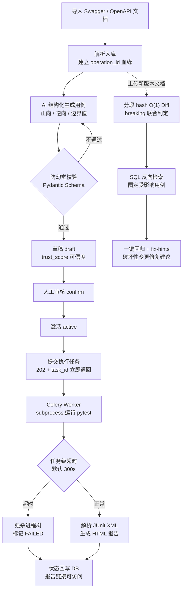
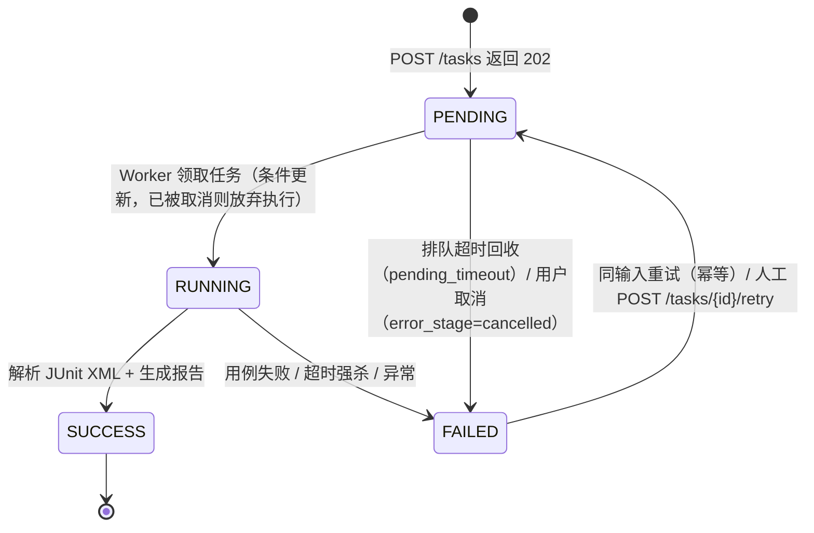

<div align="center">
  <h1>智能化接口测试效能平台 · 后端</h1>

  <p>
    <a href="https://github.com/Testamentt/ApiTestPlatform_Backend/actions/workflows/ci.yml"></a>
    
    
    
    
    
    
    
    
  </p>

  <p>
    <strong>AI 提效 + 异步解耦 + 精准回归</strong> ——<br>
    让用例编写从「重复劳动」变为「审核确认」，让回归范围从「经验猜测」变为「血缘圈定」，让执行从「阻塞卡死」变为「异步兜底」。
  </p>
</div>

> **定位**：后端项目入口（亮点 / 快速开始 / 目录结构 / 常见问题） ｜ **状态**：现行有效 ｜ **最后核对**：2026-10-08
> **文档地图**：[docs/README.md](docs/README.md)（技术文档总览 + 写作规范） ｜ **双轨镜像**：`E:\Project\docs-study\TestPlatform\backend\README.md`
> **历史记录**：`docs/plans/`、`docs/sessions/`、`docs/reviews/`（过程记录，不回改）

## 1. 项目描述

基于 FastAPI + Celery + AI 的接口测试效能平台后端，打通「用例智能生成 → 变更影响圈定 → 异步执行 → 报告输出」完整测试闭环。配套 Vue 3 前端独立仓库：[ApiTestPlatform_Frontend](https://github.com/Testamentt/ApiTestPlatform_Frontend)。

## 2. 项目预览

<!-- TODO: 补充截图（docs/images/）：Swagger UI 生成链路一张 + 任务执行 / HTML 报告一张，或录一张 GIF -->

暂无截图。后端自带 **Swagger UI 交互界面**（`/docs`，带 Authorize 鉴权按钮），任务执行产出**自包含 HTML 报告**；配套前端四页（仪表盘 / 用例管理 / 任务执行 / AI 生成）见前端仓库。

## 3. 核心技术攻坚

| 接口测试痛点 | 平台方案 | 结果数据 |
| :--- | :--- | :--- |
| 用例编写重复耗时 | AI 解析 OpenAPI 结构化生成 + 人工审核兜底 | 单接口编写耗时降低约 80% |
| 变更后回归范围凭经验 | 接口血缘 + 分段哈希比对自动圈定 | 影响圈定 <10 s |
| 同步执行阻塞卡死 | Celery 异步解耦 + 任务级超时兜底 | Web 响应稳定 <50 ms |
| 质量缺乏度量门禁 | CI 三 job 门禁 + 全链路追踪 | 测试覆盖率实测 92%（核心模块 91%，门槛 60/80） |

### 🧠 AI 用例智能生成

> 针对手写用例重复性高的痛点，设计「OpenAPI 解析 → 结构化 Prompt → LLM 生成 → 人工审核」链路：LLM 只产草稿，人始终是最后一道闸。

- **自研文档解析器** — 不依赖第三方 SDK，带容错与递归深度限制；文档超过上限（约 2 MB）直接拒绝解析，实测 320 paths / 338 operations 入库 0 warning。
- **结构化提示词** — 正向 / 逆向 / 边界值三类用例模板，prompt 层强约束每条用例至少 1 条断言；边界规则外置 `prompts/v1/boundary_rules.md`，调整规则不改代码。
- **三层防幻觉护栏** — LLM 输出先过 Pydantic Schema 严格校验，状态恒为 `draft` 禁止自动激活，`operation_id` 由服务端注入；`trust_score` 记录血缘可信度。
- **成本审计封装** — `llm_client` 唯一封装：连接 / 读超时 5 s / 60 s，瞬时异常重试上限 3 次（指数退避），输入长度预检 5 万字符；每次生成落 token 与成本审计记录。
- **极端情况兜底** — LLM 服务不可用或响应超时（生成任务总时长预算 `llm.task_timeout_seconds`，默认 600 s，**任务内自检**：`--pool=solo` 下 Celery 的 soft/hard time_limit 会被静默关闭）时任务落 FAILED 并留进度快照，同输入可重试，不阻塞其他链路。

### 🎯 接口变更影响圈定

> 针对回归范围凭经验判断的痛点，设计纯规则链路（无 LLM、零成本、无幻觉）：文档比对 → 血缘反查 → 一键回归。

- **接口血缘标记** — 用例与接口定义通过 `operation_id` 建立可反查关联，是影响分析的地基。
- **分段哈希比对** — 新版 Swagger 与历史快照按 operation 分段 sha256，O(1) 定位变更点；breaking 五场景联合判定破坏性等级。
- **影响反向检索** — SQL 反查受影响用例，附孤儿用例迁移清单。
- **一键回归与修复建议** — 圈定结果直接发起回归，破坏性变更给出 AI 修复建议（fix-hints）。
- **极端情况兜底** — 新版文档格式异常或超限时解析直接拒绝，已入库的上一版快照与存量用例不受影响，不产生半更新状态。

### ⚡ 异步执行引擎

> 针对同步调 pytest 阻塞 Web（同步超时率 30%+）的痛点，设计「Web 服务 ≠ 执行引擎」的进程隔离架构：任务状态以 DB 为单一事实源，Worker 重启任务不丢。

- **任务队列解耦** — Celery + Redis 削峰，`POST /tasks` 立即返回 `task_id`（202），前端轮询至终态，Web 进程零阻塞。
- **超时强杀兜底** — 任务级超时默认 300 s（接口可配，subprocess `communicate(timeout)` 为准，Windows `taskkill /T`、POSIX `killpg` 杀整棵树）；`scan_stale_tasks` 扫描 DB 权威状态，回收 `running` 超时**与 `pending` 排队超时（默认 600 s）**的僵尸任务，`pending` 任务可取消（`POST /tasks/{id}/cancel`）、失败任务可人工重试。
- **幂等与重试** — `run_id` Lookup-Create 去重：成功任务复用结果，失败任务同输入可重试，不产生重复执行记录；并发撞 `UNIQUE(run_id)` 时查回「赢家」返回，不抛 500。
- **可视化测试报告** — 自包含 HTML 单文件，字段转义防 XSS，按任务隔离目录落盘，经**带鉴权** `GET /api/v1/tasks/{id}/report` 读取（无鉴权 `/static` 静态面已摘除，防按 id 枚举），测试文件不外泄。
- **极端情况兜底** — Worker 异常退出时任务状态以 DB 为准，重启后由 `scan_stale_tasks` 回收僵尸任务，任务不丢、不重复执行。

### 🏭 质量门禁与工程化

> 用测试平台的标准来测这个测试平台：质量不是口号，是 CI 里每个 job 的 fail-under 阈值。

- **持续集成门禁** — GitHub Actions 三 job：ruff 静态检查 + pytest 覆盖率（全局 fail-under 60%，核心模块 80%）+ Docker 镜像构建验证，任一不达标合入即拦截。
- **接口鉴权防护** — HTTPBearer 统一依赖注入，无凭证 401 / 凭证错误 403；`/health` 免鉴权作探针，`/docs` 生产环境可一键关闭。
- **全链路追踪** — `X-Request-ID` 中间件让 Web → Celery → LLM 日志贯穿同一请求 id，故障可按 id 一次性检索定位。
- **AI 治理红线** — LLM 调用必须走唯一封装、输出必过 Schema 校验、生成结果恒为 `draft`、密钥只放 `.env`、测试必 mock LLM。
- **工程红线** — 禁止吞异常、外部调用必设 timeout（值来自 config）、SQLite 强制 WAL 模式。

## 4. 系统流程

### 主流程（活动图）



### 任务状态机（状态图）



## 5. 技术栈

| 层次 | 技术 | 作用 |
| :--- | :--- | :--- |
| Web 服务层 | Python 3.12、FastAPI、SQLAlchemy 2.0、Pydantic Settings | REST API、六表数据访问与类型安全配置 |
| 数据存储 | SQLite（WAL + busy_timeout + foreign_keys）、Redis | 业务数据单一事实源；Celery Broker 与状态缓存 |
| 异步执行层 | Celery 5、subprocess + pytest | 任务解耦、进程隔离执行、超时强杀、报告生成 |
| AI 能力层 | DeepSeek API（OpenAI 兼容）、自研 OpenAPI 3.0 解析器、结构化 Prompt | 用例智能生成、三层防幻觉护栏与成本审计 |
| 质量与交付 | pytest、ruff、GitHub Actions、Docker Compose | 测试门禁、静态检查、CI 三 job、一键容器化 |
| 配套前端 | Vue 3、Element Plus、Pinia、Vite、Vitest | 四页管理界面与 64 个单测（独立仓库，见文首链接） |

## 6. 快速开始

### 环境要求

| 组件 | 版本 | 说明 |
| :--- | :--- | :--- |
| Python | 3.12+ | 后端运行环境 |
| Redis | 任意可用版本 | 本地 127.0.0.1:6379，需设置 requirepass |
| Docker Desktop | 可选 | 一键容器化演示，免装 Python / Redis |
| DeepSeek API Key | 可选 | 仅 AI 用例生成功能需要，配置在 `.env` |

### 常见命令

| 命令 | 作用 |
| :--- | :--- |
| `pytest -q` | 后端测试门禁（单元 / 接口 / 任务） |
| `ruff check .` | 静态检查 |
| `python scripts/doc_check.py` | **文档漂移门禁（P3-6）**：源文档链接/围栏/H2 编号 + 学习版镜像原子块与废弃口径；CI 已接入 |
| `python scripts/fix_report_links.py [--dry-run]` | **旧库 report_link 迁移（P3-3）**：`/static/{id}/report.html` → `/api/v1/tasks/{id}/report`（幂等） |
| `scripts\start_all.bat` | 一键拉起 Web + Worker（两个窗口） |
| `scripts\reset_db.bat` | 重置开发库（schema 漂移时） |
| `python scripts/mock_target.py` | 启动本地被测 mock 服务（:9999） |
| `docker compose up --build` | 容器一键演示（mock + Web + Redis + Worker） |

### 后端启动

```bash
# 1. 安装依赖
python -m venv .venv
.venv\Scripts\activate          # Windows；Linux/macOS 用 source .venv/bin/activate
pip install -e ".[dev]"

# 2. 初始化配置
copy config\settings.example.yaml config\settings.yaml
copy .env.example .env          # 编辑 .env：填入 Redis 密码；AI 生成功能再填 DEEPSEEK_API_KEY

# 3. 启动本地被测 mock 服务（另开终端，保持运行）；.env.example 的 execution.base_url 即指向它
python scripts/mock_target.py   # 监听 127.0.0.1:9999

# 4. 启动 Web 服务
uvicorn app.main:app --port 8000

# 5. 启动 Celery Worker（Windows 必须 --pool=solo）
celery -A app.celery_app:celery_app worker --pool=solo

# 步骤 4/5 也可用 scripts\start_all.bat 一键拉起
```

启动后验证：

- Swagger UI 界面：`http://127.0.0.1:8000/docs`（右上角 Authorize，token 默认 `testplatform-dev-token`）
- 健康探针：`http://127.0.0.1:8000/health`

免装环境时可用 Docker 一键演示（替代步骤 1~5，内置 mock 服务，全离线可复现）：

```bash
docker compose up --build
```

### 被测系统接入（两种形态，`execution.base_url` 切换）

| 形态 | 说明 | 适用 |
| :--- | :--- | :--- |
| **离线 mock** | `scripts/mock_target.py`（httpbin 兼容子集：`/get`、`/post`、`/status/{code}`、`/delay/{n}`、`/bearer`） | 日常演示——全离线可复现，不依赖外网 |
| **管伊佳ERP**（真实业务系统） | 本机 `:9999/jshERP-boot`；Swagger2 文档经 `scripts/convert_swagger2.py` 转 OpenAPI3 入库（320 paths / 338 operations），执行层自动登录取 token 注入请求头 | 真实业务链路演示（端到端冒烟 4/4 passed） |

真实系统需要登录态时，执行层按 `execution.auth_*` 配置自动适配；凭证只放 `.env`（`ERP_TEST_USERNAME/PASSWORD`），生成的测试文件不含密钥。详见 [docs/execution-engine.md](docs/execution-engine.md)。

### 前端启动

```bash
git clone https://github.com/Testamentt/ApiTestPlatform_Frontend
cd ApiTestPlatform_Frontend     # 需要 Node ≥ 20 + pnpm 10
pnpm install
pnpm dev                        # http://localhost:5173（Vite 代理 /api、/docs 到后端 8000）
```

首次打开在顶栏「令牌」输入 `testplatform-dev-token`，详见前端仓库 [README](https://github.com/Testamentt/ApiTestPlatform_Frontend)。

## 7. 目录结构

```text
ApiTestPlatform_Backend/        # 本仓库（后端）
├── app/
│   ├── api/                    # 路由层（不写业务逻辑）
│   ├── schemas/                # Pydantic 请求 / 响应模型
│   ├── services/               # 业务层（生成 / 执行 / 影响分析）
│   ├── repositories/           # 数据访问层
│   ├── models/                 # SQLAlchemy 六表模型
│   ├── tasks/                  # Celery 异步任务
│   ├── core/                   # 配置加载、数据库连接、异常与日志
│   ├── middleware/             # X-Request-ID 全链路追踪中间件
│   └── utils/                  # llm_client、subprocess 等外部调用唯一封装
├── prompts/v1/                 # 结构化 Prompt（system / user / fix-hints / 边界规则）
├── config/                     # settings.yaml 分段配置（Pydantic Settings）
├── scripts/                    # mock_target / start_all / reset_db 等脚本
├── tests/                      # 单元 / 接口 / 任务 / e2e 测试
├── docs/                       # architecture / api / database 等专题文档
└── docker-compose.yml          # mock + Web + Redis + Worker 一键编排
```

## 8. 常见问题

| 现象 | 处理方式 |
| :--- | :--- |
| `GET /cases` 返回 500 提示缺列 | `create_all` 不 ALTER 旧表导致 schema 漂移：运行 `scripts\reset_db.bat` 重置 dev 库（数据可丢，已 gitignore），或手动 `ALTER TABLE` 补列 |
| Celery Worker 启动报错 | Windows 本地必须加 `--pool=solo`（不支持 prefork 池） |
| 接口返回 401 / 403 | Bearer Token 未配置或错误：Swagger 右上角 Authorize 填 `testplatform-dev-token`，或修改 `.env` 的 `TESTPLATFORM_SECURITY_API_TOKEN`；若开了 JWT 通道，需带 `exp` 且用 `security.jwt_secret` 验签通过 |
| 接口返回 429 | 触发了限流（P3-8c）：`security.rate_limit_per_minute` 调大或置 0 关闭；提示里带窗口长度 |
| 历史任务点「报告」404 | 旧任务行仍存 `/static/...`（该静态面已摘除）：跑 `python scripts/fix_report_links.py` 迁移（P3-3） |
| Web 服务连不上 Redis | 确认 127.0.0.1:6379 可达，`.env` 中 `TESTPLATFORM_REDIS_PASSWORD` 与实际 requirepass 一致（密码含 `@ : / #` 也会被正确转义，P3-1） |
| AI 生成任务一直排队 / 失败 | 确认 Worker 已启动、`DEEPSEEK_API_KEY` 已填入 `.env`；生成任务总时长预算 llm.task_timeout_seconds（默认 600 s，任务内自检并透传到每次 LLM 调用） |
| 执行任务 FAILED | 确认被测服务已启动（`python scripts/mock_target.py`），`execution.base_url` 与之一致；同输入任务可直接重试 |
| 别的环境的消息被我的 Worker 消费了 | 多环境共用一个 Redis：按环境改 `TESTPLATFORM_CELERY_QUEUE`（P3-2，默认 `testplatform`） |
| 不想装本地环境 | `docker compose up --build` 一键拉起 mock + Web + Redis + Worker，内置默认 token |

## 9. 文档索引

| 文档 | 内容 |
| :--- | :--- |
| [docs/README.md](docs/README.md) | **文档地图 + 统一写作规范 + 双轨映射**（从这里进） |
| [docs/architecture.md](docs/architecture.md) | 双界面、后端三层、进程隔离、异步模型、核心决策 |
| [docs/database.md](docs/database.md) | 数据模型（6 表字段级设计 + 状态机） |
| [docs/api.md](docs/api.md) | REST API 设计（端点总表 + 错误码表） |
| [docs/execution-engine.md](docs/execution-engine.md) | Celery 任务、subprocess 执行、超时与僵尸回收、被测系统接入、HTML 报告 |
| [docs/ai-generation.md](docs/ai-generation.md) | OpenAPI 解析、Prompt 设计、LLM 护栏、draft→active 审核流 |
| [docs/impact-analysis.md](docs/impact-analysis.md) | 变更影响分析算法、一键回归、fix-hints |
| [docs/configuration.md](docs/configuration.md) | 配置管理（九段配置 + env 覆盖 + 三处同步清单） |
| [docs/roadmap.md](docs/roadmap.md) · [docs/TODO.md](docs/TODO.md) | 迭代方向（活文档）· 分阶段完成项台账 |
| `docs/plans/` · `docs/sessions/` · `docs/reviews/` | 计划 / 会话沉淀 / 评审与代码审查报告（过程记录，本地归档） |

## 10. 开源说明

本项目为个人独立开发的技术作品，用于学习交流与面试展示。

- 代码结构与实现思路欢迎参考、交流；如需复用请先提 Issue 沟通。
- 前端仓库：[ApiTestPlatform_Frontend](https://github.com/Testamentt/ApiTestPlatform_Frontend)（Vue 3 四页管理界面）。
