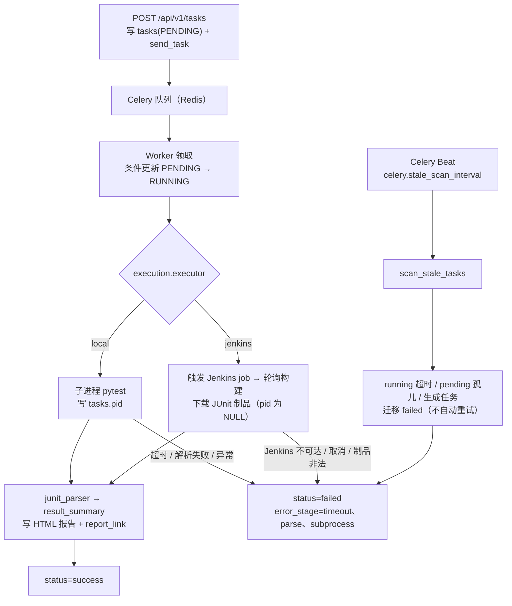

<!-- 本项目编码格式：UTF-8（无 BOM）。 -->
# 架构设计（architecture.md）

> 定位：系统长什么样：分层、进程隔离、执行器抽象、异步模型与关键取舍。
> 事实源：`app/main.py`、`app/api/v1/`、`app/services/`（含 `executors/`）、`app/tasks/supervisor.py`、`app/celery_app.py`、`docker-compose.yml` ｜ 最后核对：2026-11-12

## 1. 目标与非目标

**目标**：覆盖「创建用例 → 异步执行 → 查看结果」的完整链路，并扩展「接口变更自动圈定影响」与「AI 辅助用例生成」。执行位置可切换：平台自起 pytest 子进程，或把构建投递给 Jenkins 后回读 JUnit 制品（`execution.executor`）。双界面：Swagger UI + `frontend/` Vue 3 四页（仪表盘 / 用例管理 / 任务执行 / AI 生成）。

**非目标（当前不包含）**：
- 多环境管理：base_url 写死 config。
- 分布式全局限流与配额分级：目前只有单机固定窗口限流（`security.rate_limit_per_minute` 默认 0 = 关闭；Redis 不可用降级放行），见 configuration.md §2.8。

**影响分析已落地**（parse/impact，纯规则 Diff+SQL 秒回）——见 [impact-analysis.md](impact-analysis.md)。
**AI 生成已落地**（generate/fix-hints，LLM 异步 + 三层防幻觉护栏）——见 [ai-generation.md](ai-generation.md)。

各阶段交付物见 [roadmap.md](roadmap.md)。

## 2. 架构总览（双界面 + 后端三层）

```text
用户 / CI 系统 / Vue 前端（frontend/，前端已实现 4 页）
   │ REST /api/v1
   ▼
┌──────────────────────────────────────────────────────────────┐
│ 【界面层】FastAPI Swagger UI（/docs）+ Vue 3（frontend/）      │
│   Vue dev 走 Vite 代理（/api、/docs）同源访问后端              │
└──────────────────────────┬───────────────────────────────────┘
                           │ HTTP JSON
                           ▼
┌──────────────────────────────────────────────────────────────┐
│ 【Web 服务层】 FastAPI + SQLAlchemy（同步 def 端点 + 线程池）    │
│   ├─ 用例 CRUD + 审核    /api/v1/cases                         │
│   ├─ 任务触发/查询       /api/v1/tasks                          │
│   ├─ Swagger 解析/影响    /api/v1/parse、/api/v1/impact/*        │
│   ├─ AI 生成             /api/v1/generate（异步 202）            │
│   └─ 健康检查            /api/v1/health                        │
│     ① 写 DB 任务记录(status=PENDING)   ② send_task 入队       │
└──────────────────────────┬───────────────────────────────────┘
                           ▼
┌──────────────────────────┐
│ 【Redis Broker】          │ ← 消息中转（Celery 队列）
│  ── ③ Worker 拉取任务     │
└──────────────────────────┘
                           ▼
┌──────────────────────────────────────────────────────────────┐
│ 【执行引擎层】 Celery Worker（独立进程，--pool=solo）            │
│   execute_cases: 按 execution.executor 选执行器                 │
│      local：生成 test_xxx.py → subprocess pytest               │
│        （run_cmd：白名单 + timeout + taskkill /T /F 兜底）      │
│      jenkins：触发构建 → 轮询 → 下载 JUnit 制品                 │
│      解析 JUnit XML → result_summary（含 executor/build_url）   │
│      → HTML 报告（report_link 指向带鉴权的报告端点）             │
│   generate_cases: parse → 逐 op LLM → draft 落库 → 审计        │
│      （llm_client 唯一封装，短事务分界，三层防幻觉护栏）         │
│   scan_stale_tasks: Beat 周期回收（超时 running / pending 孤儿）│
└──────────────────────────────────────────────────────────────┘
```

## 3. 进程隔离与故障边界

- **Web 服务 ≠ 执行引擎**：任务同步入队、异步执行，FastAPI 挂掉不影响正在执行的测试。pytest 跑在哪里由 `execution.executor` 决定：`local` 在 Worker 内起子进程，`jenkins` 由 Jenkins agent 执行；两种实现共用同一套状态机、事务边界与报告解析口径，Web/Worker 不感知差异（细节见 [execution-engine.md](execution-engine.md) §10）。
- **任务不丢**：任务状态持久化在 SQLite `tasks` 表，**DB 是唯一状态源**；Celery result backend 仅辅助（`result_expires=3600`）。
- **超时兜底**：`tasks.pid` 记录本地 pytest 进程 PID（mark_running 条件更新写入，Jenkins 执行时为 NULL）；`scan_stale_tasks` 从 DB 读 pid 杀整棵树（**权威兜底**，Windows `taskkill /T`、POSIX `killpg`）——执行任务与生成任务均被扫描（阈值：执行=任务级 `timeout_seconds`，生成=`llm.task_timeout_seconds`），另回收 `pending` 排队孤儿（基础 `celery.pending_timeout`，并按队列位置叠加前序任务超时预算，solo 串行排队不误杀）。
- **回收不能只靠重启**：僵尸回收由 **Celery Beat 周期**触发（`celery.stale_scan_interval` 默认 60 s，配置为 0 即关闭），外加 Worker 启动补扫；只有启动扫描时，Worker 长期不重启会让 running 任务一直挂着、排队孤儿永久占用 `run_id`。Beat 是独立进程（compose 的 `beat` 服务、本地 `scripts/start_beat.bat`），与 Worker 各自重启。
- **链路可追踪**：`RequestIdMiddleware` 生成/透传 `X-Request-ID` 并回写响应头，派发时随任务参数跨进程传入 Worker，Worker 侧恢复同一 id 并装上同一套日志格式（`celery_app.configure_worker_logging`），日志可跨 Web → Celery → LLM 检索。

## 4. 异步任务与超时兜底模型

统一异步模式（execute 执行 + generate 生成，两套独立任务表与状态机）：

1. Web 层算 `run_id`（sha256(输入指纹)）→ **查重（SUCCESS 复用 / FAILED 重置 PENDING 重新入队 / 其余返回现状）** → 否则写 DB 记录（PENDING）→ `send_task` → **立即返回 202**；入队失败落 `FAILED(dispatch)` + 503（统一由 `dispatcher.dispatch_or_fail` 兜底，执行/生成共用）
2. 客户端轮询 `GET /api/v1/tasks/{id}` 或 `GET /api/v1/generate/{id}` 获取状态与结果
3. Worker 内短事务写入结果（先查 → 提交关事务 → 算 → 再开新事务写入，事务内不调 LLM / subprocess）

Celery 关键配置：`task_acks_late=True` + `worker_prefetch_multiplier=1` + `task_reject_on_worker_lost=True`；执行任务 `soft_time_limit`/`time_limit` 按任务级 `timeout_seconds` 派生（缺省 `300` → soft `330` / hard `360`，并受 `visibility_timeout` 上界约束）；生成任务 `soft_time_limit`/`time_limit`（540/600，软超时捕获 `force_fail_timeout` 落 FAILED）+ **任务内 deadline 自守**（`--pool=solo` 下 Celery 时间限制被静默关闭）；`visibility_timeout`(1h) > 各任务 `time_limit`。
- **任务幂等**：`run_id`（sha256）+ `UNIQUE`；Lookup-Create 语义 = SUCCESS 复用 / FAILED 可重试（重置 PENDING 重新入队，任务函数有状态守卫）/ PENDING/RUNNING 返回现状，防重复执行、防重复调用 LLM；并发撞唯一约束时查回既有任务返回。
- **超时劫持**（唯一详述见 [execution-engine.md](execution-engine.md) §5）：Celery **Beat 周期扫描**（`celery.stale_scan_interval`，默认 60 s）+ Worker 启动补扫，覆盖执行任务（任务级 `timeout_seconds` 阈值，杀整棵进程树）与生成任务（`llm.task_timeout_seconds` 阈值）；`pending` 孤儿按「基础宽限 + 前序任务超时预算」判定，solo 串行排队不会被误杀；**扫描不自动重试**（用户可同输入重新提交或调 `POST /tasks/{id}/retry` 触发）。

执行任务的路径与终态来源：



图中两条执行路径在 `ExecutionService` 汇合：状态迁移、条件更新与报告落盘只有一份实现，`error_stage` 按错误码分类（`jenkins`/`timeout`/`parse` 等），因此切换执行器不改变任务状态语义。

## 5. 核心数据流时序（执行链路）

```text
1. POST /api/v1/tasks {case_ids, timeout_seconds?}（base_url 写死 config）
2. Web: 校验用例均 active（draft 禁止执行）→ run_id 查重（SUCCESS 复用 / FAILED 重置重试 / 其余返回现状）→ 写 PENDING → send_task → 202
3. Worker execute_cases:
   a. 读 task → active 用例列表（case_ids 快照）
   b. get_executor() 按 execution.executor 选实现（local | jenkins）
      · local：建按 task_id 隔离的 workspace .workspace/tasks/{task_id}/ → 逐用例生成
        test_{case_id}.py（结构化字段 repr 渲染；契约层基线状态码断言恒渲染 + assertions 逐条渲染求值）
        → run_cmd([python -m pytest ... --junitxml=report.xml],
                  timeout=task.timeout_seconds（缺省 pytest_timeout）, check=False)
      · jenkins：触发参数化 job（TASK_ID / CASE_IDS / BASE_URL）→ 等队列分配 → 轮询构建
        → 下载 jenkins.artifact_path 指向的 JUnit 制品；本机无 pytest 进程
   c. on_start 回调先写 tasks.pid + status=running + started_at（local 抢在超时之前；
      jenkins 传 None，条件更新照旧，取消竞态守卫不变）
   d. 超时 → local 由 run_cmd best-effort kill，jenkins 由轮询 deadline 收敛 → failed(error_stage=timeout)
      权威清理靠 scan_stale_tasks（local）；Jenkins 侧构建由 Jenkins 自行收尾
   e. 正常结束 → junit_parser 累加各 testsuite → 组 result_summary
      {total, passed, failed, skipped, duration_ms, results, executor, build_url}
   f. report_util 写 report.html（best-effort，无结果也生成）→ report_link（带鉴权端点）→ status=success
4. 客户端轮询 GET /api/v1/tasks/{id} → 读 GET /tasks/{id}/results 逐用例明细 → 取 GET /tasks/{id}/report 报告原文
```

### 5.1 影响分析链路（纯规则，同步 <1s，无 AI）

```text
1. POST /api/v1/parse {document, version?} → 解析 → 分段 hashes + contracts → 落库 api_definitions（reparse 覆盖）→ 201
2. POST /api/v1/impact/analyze {document, new_version?, old_version?} → 解析新版 → diff + breaking 联合判定
   → SQL 反向检索（breaking 变更的 active 用例 / removed 的 orphaned / 未绑的 untested）→ 落库 impact_analyses → 200
3. POST /api/v1/impact/{analysis_id}/regression → 宽容降级过滤失效用例 → 复用执行闭环执行引擎 → 202 {task_id} → 轮询
```

### 5.2 AI 生成链路（Celery 异步，LLM 不阻塞 Web）

```text
1. POST /api/v1/generate {document, operation_ids?, force_full?} → run_id=sha256(document+operation_ids) Lookup-Create 幂等
   → 显式操作 ids 全部未命中 → 422 INVALID_OPERATION_IDS（入口 fail-fast）
   → 落库 generation_tasks(PENDING, document) → generate_cases_task.delay(task_id) → 202
2. Worker generate_cases_task（任务内 deadline = llm.task_timeout_seconds=600，solo 池下 Celery limit 不生效）：
   → parse_openapi → 过滤定向 operation_ids（未命中的记 skipped_detail，不静默）
   → 逐 operation：prompts/v1 渲染 → llm_client.chat_json（response_format + _extract_json）→ Pydantic 严格校验
   → 通过：operation_id 服务端注入 + trust_score(warnings?60:80) → 落库 draft
   → 失败：generation_logs(validation_failed + raw_response + confidence=0) → 不建坏用例
   → result_summary {generated, draft_created, rejected, rejected_detail, skipped_*, prompt_version, cost_total, redacted} → SUCCESS
3. GET /cases?status=draft 查生成用例 → POST /cases/{id}/confirm（reviewer）→ active → 可执行
4. POST /impact/{id}/fix-hints（联动）：breaking 变更按需生成一句话修复建议（复用 llm_client，best-effort）
```

## 6. 关键设计决策

| 决策 | 理由 |
| :--- | :--- |
| 异步解耦 | Web 只写 DB + send_task 立即返回 202；pytest/LLM 在独立 Worker（或 Jenkins agent），Web 不阻塞 |
| 执行器抽象 | 「在哪里跑」收敛为配置项 `execution.executor`，编排层只依赖 `Executor` 协议（`app/services/executors/`）；新增执行器的成本是「加一个实现 + 工厂注册一行」，不动状态机与事务边界 |
| 超时兜底双保险 | `run_cmd(timeout)`（local）/ 轮询 deadline（jenkins）+ **`scan_stale_tasks` 从 DB 读 pid 杀整棵树**（权威，含 pending 排队孤儿回收），并由 Beat 周期触发 + Worker 启动补扫；生成链路额外用任务内 deadline 自守 |
| run_id Lookup-Create | sha256 + UNIQUE；SUCCESS 复用、FAILED 重置重试、其余返回现状，防重复执行、防重复调用 LLM；并发撞约束查回赢家 |
| `operation_id` NOT NULL | 影响分析血缘 + AI 生成服务端注入 |
| breaking 判定 | 六类联合判定：required 收紧、type 变化、枚举删减、字段删除、响应状态码删减/替换、契约缺失安全默认；仅放宽类不圈定（见 [impact-analysis.md](impact-analysis.md) §2） |
| 三层防幻觉护栏 | extra="forbid" 严格校验 + draft 恒为人工 confirm + operation_id 服务端注入（见 [ai-generation.md](ai-generation.md) §6） |
| LLM 唯一封装 | llm_client 收敛超时/重试/长度预检/成本，测试可注入 Fake |
| 双界面 | Swagger UI（`/docs`）+ Vue 3 四页（frontend/，dev 走 Vite 代理 `/api`、`/docs`） |

## 7. 前端形态（双界面，前端已实现）

- **后端界面 = FastAPI Swagger UI（`/docs`）**：所有操作（创建用例 / 审核 draft / 触发执行 / 查看任务 / HTML 报告链接）可直接在 Swagger UI 完成。**自带 Authorize 按钮**（Bearer Token 鉴权）；`/docs` 由 `app.docs_enabled` 配置开关控制，生产设 `TESTPLATFORM_APP_DOCS_ENABLED=false` 即关。
- **Vue 3（前端已实现）**：`frontend/` 独立仓库（Vue 3 + TS + Element Plus + Pinia），4 页——仪表盘（流水线/统计/健康）、用例管理（CRUD + confirm）、任务执行（2s 轮询 + 结果抽屉 + 取消/重试 + 报告）、AI 生成（Swagger 粘贴/上传 + 草稿审核激活 + 跳过/被拒明细）；`vitest` 单测 + `vue-tsc` 构建门禁；dev 经 Vite 代理（`/api`、`/docs`）同源访问后端，不依赖 CORS。

## 8. 目录结构（backend/ 仓库）

```text
backend/
├── pyproject.toml / .env / config/settings.yaml / alembic(延后)
├── Dockerfile / docker-compose.yml / .dockerignore   # 容器化（api / worker / beat / redis / mock）
├── Jenkinsfile                                       # Jenkins 声明式流水线（JUnit / coverage / Allure 报告）
├── .github/workflows/ci.yml                          # CI（门禁测试 + slow + docker-build，含报告发布与归档）
├── app/
│   ├── main.py               # 应用入口（路由聚合 + 异常 handler + lifespan 建表）
│   ├── celery_app.py         # Celery app（显式读 Settings 拼 broker/backend + Beat 调度表 + worker_ready 补扫）
│   ├── core/                 # config / database / logging / exceptions
│   ├── middleware/           # request_id（X-Request-ID 生成/透传/回写 + 日志 Filter）
│   ├── api/v1/               # 路由 + deps（cases / tasks / health / parse / impact / generate）
│   ├── models/               # SQLAlchemy ORM（test_cases / tasks / api_definitions / impact_analyses / generation_tasks / generation_logs 表）
│   ├── schemas/              # Pydantic 出入参（case / task / swagger / impact / generate / assertion / common）
│   ├── services/             # 业务编排（case / task / execution / swagger / impact / generation + dispatcher 统一入队单点）
│   │   └── executors/        # 执行器契约与实现（base 协议 / local / jenkins / get_executor 工厂）
│   ├── repositories/         # 数据访问（case / task / api_definition / impact_analysis / generation_task，物理删除）
│   ├── tasks/                # Celery 任务（execute_cases.py / supervisor.py 内含 scan_stale_tasks / generate_cases.py）
│   └── utils/                # subprocess_util / jenkins_client / openapi_parser / llm_client / impact_diff / case_generator / junit_parser / report_util / prompt_util
├── prompts/v1/               # 版本化 Prompt（system/user/boundary_rules/fix_hint_{system,user}.md，占位符注入，写死 v1）
├── scripts/                  # mock_target / start_all / start_worker / start_beat / reset_db / jenkins_smoke / doc_check
└── docs/  tests/
```

依赖单向：`api → service → repository → model`；外部调用（subprocess / HTTP / LLM）统一走 `app/utils/` 封装。`frontend/` 为独立 git 仓库（前端已实现，Vue 3 四页）。

## 9. 预期与风险

- 预期：Web 响应稳定 <50ms（异步解耦，不阻塞在 pytest/LLM 上）；单个任务可跑 10+ 用例；死循环用例被超时强杀，系统不卡死；AI 生成 draft 供人工审核。
- 并发口径：**任务之间是串行的**——部署固定单 Worker（`--pool=solo --concurrency=1`，单写者写 SQLite）；"10+ 用例"指**同一任务内**的用例条数。
- 门槛口径：全项目覆盖率门槛 60%（`pyproject.toml`），核心模块（services+utils）≥80%（CI 单独 fail-under）。当前 `pytest -q` 为 412 passed / 4 deselected（慢用例默认排除），全项目覆盖率见最新 CI（2026-11-12 本地全量实测，计数与覆盖率以最新 CI 运行为准）。
- 风险：SQLite 双进程并发写（WAL + busy_timeout + 单 Worker 串行规避）；外部依赖（被测系统可达性、LLM 端点可用性、Jenkins 可用性：单测用 mock 与 `httpx.MockTransport` 隔离，真实链路另跑 `slow` e2e）；杀树在目标平台不可用时降级（`scan_stale_tasks` 兜底 + 失败留 warning）；切换到 Jenkins 执行器需要 Jenkins 侧有参数化 job，参数契约见 [execution-engine.md](execution-engine.md) §10。

## 10. 相关文档

- [README.md](README.md) — 文档地图与阅读路径
- [database.md](database.md) — 数据模型（6 表字段级 + 状态机）
- [api.md](api.md) — REST API 设计（端点总表 + 错误码表）
- [execution-engine.md](execution-engine.md) — Celery 任务、执行器抽象（local / Jenkins）、超时与回收
- [ai-generation.md](ai-generation.md) — AI 用例生成（Prompt 管理 + llm_client + 三层护栏 + 审计）
- [impact-analysis.md](impact-analysis.md) — 影响分析算法（含 fix-hints）
- [configuration.md](configuration.md) — 配置管理（含 `jenkins.*`）｜ [roadmap.md](roadmap.md) — 迭代路线
