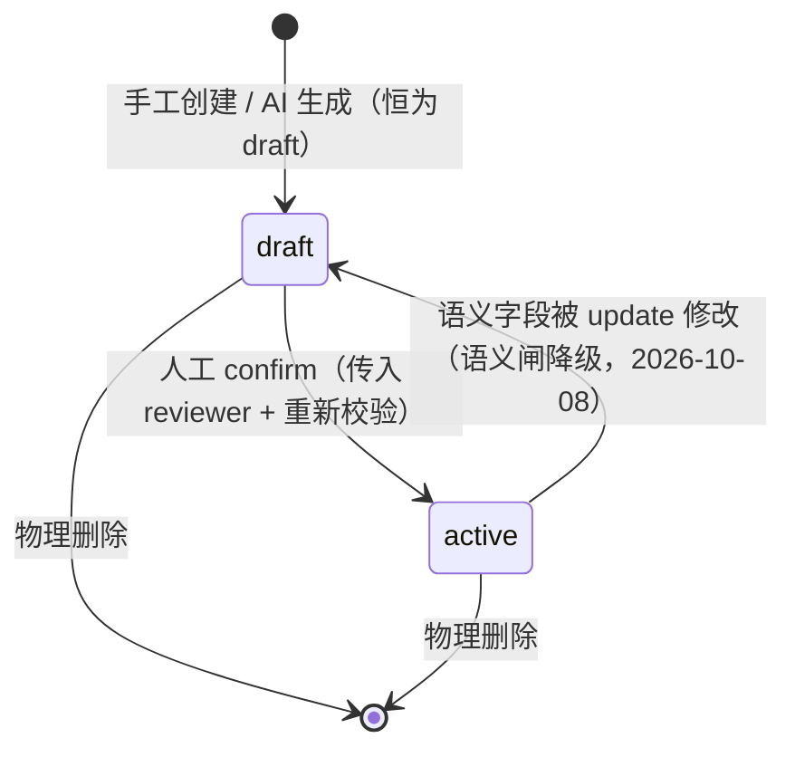
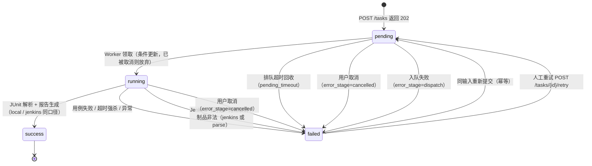
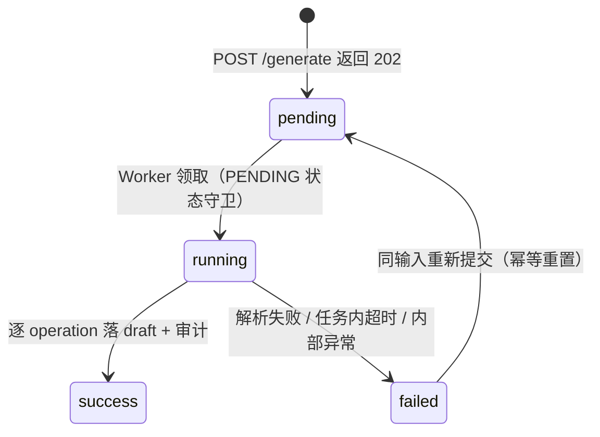

<!-- 本项目编码格式：UTF-8（无 BOM）。 -->
# 数据库设计（database.md）

> 定位：数据怎么存，包括六张表的列与约束、索引、状态机与迁移策略。
> 事实源：`app/models/*.py`、`app/core/database.py`、`app/repositories/` ｜ 最后核对：2026-11-12

字段名与表名在 [api.md](api.md)、[execution-engine.md](execution-engine.md) 中保持一致；软删除、多环境、结果明细表当前不建（理由见 §1，升级路径见 §4，未建表清单见 §6）。

## 1. 设计原则（当前取舍）

| 原则 | 要求 |
| :--- | :--- |
| 连接工厂 | 所有连接经唯一 `get_engine()` 创建，方言差异收敛在 `is_sqlite_url` / `engine_kwargs` 两个纯函数：SQLite connect 事件统一执行 `PRAGMA journal_mode=WAL` / `busy_timeout=5000` / `foreign_keys=ON`，并必加 `connect_args={"check_same_thread": False}`（FastAPI 线程池跨线程使用 SQLite 会报 "created in a thread"）；其它方言（PostgreSQL）走 `pool_pre_ping=True`，不吃 SQLite 的 pragma |
| 建表 | `Base.metadata.create_all(engine)`（main lifespan 启动时同步执行一次，阻塞无妨）；无 Alembic（见 §4） |
| 短事务 | 禁止持有 Session 期间调用 subprocess/HTTP；统一「先查 → 提交关事务 → 算 → 再开新事务写入」 |
| 删除 | 物理删除 `db.delete()`；不建软删除列 |
| 命名 / 时间 / 枚举 | `snake_case`；主键统一 `id`；时间存 UTC naive（DB/ORM 生成）；状态列 `StrEnum` + `String` |
| 状态机 | 顺序迁移 + 显式 if 守卫；失败必须记 `error_stage` 与 `error_msg` |

建表与删除的取舍都以「单机单写、无保留历史数据需求」为前提：create_all 只建不存在的表、不 ALTER 旧表；软删除列会让每条查询都带状态条件，收益不足。代价与升级条件见 §4。

## 2. 表结构（6 张）

> 建表阶段：执行闭环 建 `test_cases` + `tasks`；影响分析 建 `api_definitions` + `impact_analyses`；AI 生成 建 `generation_tasks` + `generation_logs`。生产化与前端 未新增表。

### 2.1 test_cases（用例表）

| 字段 | 类型 | 约束/默认 | 说明 |
| :--- | :--- | :--- | :--- |
| id | INTEGER | PK, autoincrement | |
| name | VARCHAR(255) | NOT NULL | 用例名 |
| method | VARCHAR(16) | NOT NULL | GET/POST/PUT/PATCH/DELETE/HEAD/OPTIONS（白名单校验） |
| path | VARCHAR(1024) | NOT NULL | 接口路径（不含 base_url） |
| operation_id | VARCHAR(255) | NOT NULL, 索引 | 血缘映射（创建时 Schema 必填；影响分析依据） |
| params | JSON | NULL | query 参数 |
| body | JSON | NULL | 请求体 |
| expected_status | INTEGER | NOT NULL DEFAULT 200 | 期望状态码（执行引擎恒渲染契约层基线断言） |
| assertions | JSON | NULL | 断言规则列表（`AssertionItem`：path/op/value，路径白名单正则）；执行引擎逐条渲染进生成的 pytest 文件求值（2026-09 断言引擎上线） |
| status | VARCHAR(16) | NOT NULL DEFAULT 'draft' | draft/active/archived（StrEnum） |
| source | VARCHAR(16) | NOT NULL DEFAULT 'manual' | manual/ai/swagger |
| trust_score | INTEGER | NOT NULL DEFAULT 100 | 血缘可信度 0-100：手工=100；AI 用例逐条计算（`app/services/case_quality.py`，100 起评按项扣分）；`CaseRead` API 可观测，扣分原因见 `quality_flags`；低分需重点复核 |
| quality_flags | JSON | NULL | AI 用例的扣分原因，`[{reason, penalty}]`；手工用例为 NULL。why 单独成列而不并入 `generation_logs`：审计日志的粒度是「一次 LLM 调用」（一个 operation 一行），装不下逐条用例结论 |
| reviewer | VARCHAR(64) | NULL | 批准人审计：`confirm` 写入；`active` 用例被 update 改动语义字段时由语义闸清空（批准随内容失效，2026-10-08） |
| created_at / updated_at | DATETIME | NOT NULL, server_default=now / onupdate | |

索引：`ix_test_cases_operation_id(operation_id)`（SQLAlchemy `index=True` 默认前缀）、`idx_test_cases_status(status)`。

### 2.2 tasks（执行任务表，结果直接落 result_summary JSON）

| 字段 | 类型 | 约束/默认 | 说明 |
| :--- | :--- | :--- | :--- |
| id | INTEGER | PK | |
| run_id | VARCHAR(64) | NOT NULL, UNIQUE | `sha256(json.dumps({case_ids: sorted(...), timeout}, sort_keys=True))` 指纹（Lookup-Create 幂等键） |
| case_ids | JSON | NOT NULL | 用例 id 快照（执行时冻结） |
| timeout_seconds | INTEGER | NOT NULL DEFAULT 300 | 任务级执行超时：真正控制 subprocess 超时与僵尸扫描阈值（缺省 `execution.pytest_timeout`），API 可配 1–3600 |
| status | VARCHAR(16) | NOT NULL DEFAULT 'pending' | pending/running/success/failed（StrEnum） |
| pid | INTEGER | NULL | subprocess 主进程 PID，超时劫持的权威 kill 依据（mark_running 写入；Jenkins 执行时为空） |
| celery_task_id | VARCHAR(64) | NULL | Celery task uuid |
| error_stage | VARCHAR(32) | NULL | parse/subprocess/timeout/internal/dispatch/command/cancelled/pending_timeout/jenkins（失败阶段定位；command 为未过白名单，cancelled 为用户取消，pending_timeout 为排队超时回收，jenkins 为 Jenkins 执行器侧失败） |
| error_msg | TEXT | NULL | 失败原因（含 stdout 尾部） |
| started_at / finished_at | DATETIME | NULL | |
| result_summary | JSON | NULL | `{total, passed, failed, skipped, duration_ms, results:[{case_id, status, failure_msg}], executor, build_url}`（`executor` 为 `local`/`jenkins`，`build_url` 仅 Jenkins 执行有值；`name` 由接口层默认空串兜底，junit 不提取） |
| report_link | VARCHAR(1024) | NULL | `/api/v1/tasks/{task_id}/report`（带鉴权读报告原文） |
| created_at / updated_at | DATETIME | NOT NULL, server_default=now / onupdate | |

索引：`idx_tasks_status(status)`、`UNIQUE(run_id)`。

> Lookup-Create 模式：`POST /api/v1/tasks` 先算 `run_id`，再查 `tasks.run_id`。已 SUCCESS 直接复用（不重复执行）；已 FAILED 重置 PENDING 重新入队（同输入可重试）；PENDING/RUNNING 返回现状。SQLite `UNIQUE(run_id)` 兜底并发。入队失败（Redis/Celery 不可用）落 `FAILED(error_stage="dispatch")` 并返回 503，不残留 PENDING 孤儿。
>
> FAILED→PENDING 的重置是「清空上一轮的全部执行痕迹」：`result_summary` / `report_link` / `started_at` / `pid` / `celery_task_id` / `error_stage` / `error_msg` / `finished_at` 一律置 NULL，并删除磁盘上的旧报告文件（`report_util.remove_report`）。只重置状态字段时，重试期间 `GET /tasks/{id}/results` 会回放上一轮结果、`GET /tasks/{id}/report` 会返回上一轮报告——报告端点读文件系统，光清 DB 不够。

### 2.3 api_definitions（Swagger 版本快照，影响分析）

| 字段 | 类型 | 约束/默认 | 说明 |
| :--- | :--- | :--- | :--- |
| id | INTEGER | PK, autoincrement | |
| version | VARCHAR(64) | NOT NULL, UNIQUE | 用户标签或 auto `v{n}`；reparse 覆盖（同 version 再解析先删旧插新，CI 幂等不膨胀） |
| hash_version | INTEGER | NOT NULL DEFAULT 2 | 哈希算法代际（config `swagger.hash_version`；2=sha256 指纹）；升级时旧快照不重建，diff 版本不一致时公共接口保守全标 changed（防跨算法指纹混比） |
| operation_ids | JSON | NOT NULL | 血缘全集 `[operation_id, ...]` |
| operation_hashes | JSON | NOT NULL | 分段 `{op_id: {"request": sha256, "response": sha256}}`（已从 MD5 换成 sha256，防恶意碰撞）；response 含状态码指纹（200→202 必命中） |
| operation_contracts | JSON | NOT NULL | `{op_id: {"required": [...], "signature": {field_path: {"type","enum"}}, "response_status_codes": [...]}}`，breaking 联合判定输入（含响应状态码集合，200→202 变化可判 breaking） |
| created_at / updated_at | DATETIME | TimestampMixin | |

索引：`UNIQUE(version)`。

### 2.4 impact_analyses（影响分析结果，影响分析）

| 字段 | 类型 | 约束/默认 | 说明 |
| :--- | :--- | :--- | :--- |
| id | INTEGER | PK, autoincrement | |
| old_version / new_version | VARCHAR(64) | NULL / NOT NULL | 对比版本对（首次分析 old 为空） |
| added_ops / removed_ops / changed_ops | JSON | NOT NULL | 三态集合 |
| breaking_changed_ops | JSON | NOT NULL | 唯一触发回归圈定（required 收紧、type 变、字段删、枚举删减） |
| affected_case_ids | JSON | NOT NULL | breaking 变更的 active 用例 id 快照 |
| affected_count | INTEGER | NOT NULL | 冗余计数；模型层 `@validates("affected_case_ids")` 整体赋值时同步（写入口收敛整体替换） |
| orphaned_case_ids | JSON | NOT NULL | removed 接口绑定的用例（迁移清单，不自动回归） |
| suggested_remap | JSON | NOT NULL | `{removed_op: added_op}` 相似名配对（difflib，只建议不自动重绑） |
| untested_ops | JSON | NOT NULL | 未绑 active 用例的接口清单（首次尚无 active 绑定时为全部，AI 生成 铺路） |
| affected_summary | JSON | NOT NULL | `{total}`（快照期；回归时按执行时真实口径重算） |
| last_regression_at / last_regression_task_id / last_regression_executed_count | DATETIME / VARCHAR / INTEGER | NULL | 回归结果持久化（每次一键回归更新，可追溯） |
| ai_fix_hint | JSON | NULL | 修复建议（AI 生成 预留）：breaking 变更的一句话 LLM 建议；`POST /impact/{id}/fix-hints` 按需生成（best-effort），不阻塞 analyze 纯规则秒回 |
| created_at / updated_at | DATETIME | TimestampMixin | |

### 2.5 generation_tasks（AI 生成任务，AI 生成，独立于执行 tasks 表）

| 字段 | 类型 | 约束/默认 | 说明 |
| :--- | :--- | :--- | :--- |
| id | INTEGER | PK, autoincrement | |
| run_id | VARCHAR(64) | NOT NULL, UNIQUE | `sha256(document + operation_ids)` 指纹，Lookup-Create 幂等（重复提交不重复调 LLM） |
| status | VARCHAR(16) | NOT NULL DEFAULT 'pending' | pending/running/success/failed |
| celery_task_id | VARCHAR(64) | NULL | 已持久化：`dispatcher.dispatch_generation` 统一入队返回 AsyncResult.id 后写入，卡死时可经 Celery 定位/revoke |
| document | JSON | NOT NULL | 源 Swagger（≤2MB 落库；任务入参只传 task_id） |
| operation_ids | JSON | NULL | 定向生成子集；NULL=全量/untested |
| operation_count | INTEGER | NOT NULL DEFAULT 0 | |
| prompt_version | VARCHAR(16) | NULL | SUCCESS 收尾写入；失败明细仍由 `generation_logs.prompt_version` 与 `result_summary.prompt_version` 承载 |
| error_stage / error_msg | VARCHAR/TEXT | NULL | parse/internal/timeout/dispatch（单接口失败不入任务级，记 generation_logs） |
| result_summary | JSON | NULL | `{generated, draft_created, rejected, rejected_detail:[{operation_id, reason}], skipped_by_filter, skipped_detail, prompt_version, cost_total, redacted}`（`redacted` = LLM 输出被脱敏的片段数，恒写）；任务内超时另带 `timed_out: true` 与 `timed_out_at` |
| started_at / finished_at | DATETIME | NULL | |
| created_at / updated_at | DATETIME | TimestampMixin | |

索引：`UNIQUE(run_id)`、`idx_generation_tasks_status(status)`。

### 2.6 generation_logs（逐 operation LLM 调用日志，成本 + 置信度）

| 字段 | 类型 | 约束/默认 | 说明 |
| :--- | :--- | :--- | :--- |
| id | INTEGER | PK | |
| generation_task_id | INTEGER | 可空, FK + index | 关联生成任务；fix-hints 的 LLM 调用无生成任务，该列为 NULL（model='fix_hint' 区分来源） |
| operation_id | VARCHAR(255) | NOT NULL | 本次生成接口（fix-hints 场景恒 'fix_hint'） |
| model / prompt_version | VARCHAR | NOT NULL | 区分来源（生成=model，建议=fix_hint） |
| status | VARCHAR(16) | NOT NULL | success / validation_failed / error |
| usage | JSON | NULL | `{prompt_tokens, completion_tokens, total_tokens}` |
| latency_ms | INTEGER | NULL | |
| cost_estimate | FLOAT | NULL | `total_tokens × llm.cost_per_1k_tokens / 1000`（估算） |
| raw_response | TEXT | NULL | 校验失败时保存 LLM 原始响应（可追溯） |
| error_msg | TEXT | NULL | 具体校验错误（如「字段 expected_status 类型错误」） |
| created_at / updated_at | DATETIME | TimestampMixin | |

## 3. 状态机

### 3.1 test_cases



- AI 生成恒为 `draft`，禁止任何自动化路径直接置 active（防幻觉护栏）。
- 执行引擎只能选中 active 用例；`active` 是执行资格而非永久标签，内容变更即失效并降级 `draft`。

### 3.2 tasks



顺序迁移 + 显式 if 守卫；失败必记 `error_stage`/`error_msg`；扫描本身不自动重试（重试由用户同输入重新提交或 POST retry 触发）。

`pending` 与 `running` 均可取消。`running` 先 best-effort 杀 pytest 进程树（否则状态改了进程还在跑）并跳过 revoke（消息早被 Worker 消费），`pending` 则额外 revoke 已入队消息；Jenkins 执行时 `tasks.pid` 为 NULL，杀树被跳过，构建由 Jenkins 侧自行收尾。落终态用条件更新（`WHERE status=<读到的状态>`）兜底与执行层的竞态：rowcount=0（已跑完或被重新领取）返回 409 `TASK_NOT_CANCELLABLE`，不谎报成功。取消用 `failed(error_stage=cancelled)` 承载，不扩状态枚举。

### 3.3 generation_tasks



- `generation_tasks` 复用 `GenerationStatus`（pending/running/success/failed，`app/models/enums.py`），`error_stage` 取值 parse/internal/timeout/dispatch。
- 单接口失败不迁移任务状态（记 `generation_logs` + `result_summary.rejected_detail`，任务仍 SUCCESS），与执行任务「用例失败仍 success」同口径。

## 4. 迁移策略

**当前取舍**：`init_db()` 调 `Base.metadata.create_all(engine)`，main lifespan 启动时同步执行一次（阻塞无妨）；测试库用内存 SQLite + create_all。没有 Alembic 版本目录。

**为什么**：单机单写、单库部署，没有「线上库带数据升级」的增量迁移需求；create_all 的实现成本最低，且不会引入迁移版本表这类额外状态。

**代价**：create_all 只建不存在的表，不会 ALTER 已存在表。模型改动后旧库与模型不一致，两种方向都会挂：

| 漂移方向 | 症状 | 实例 |
| :--- | :--- | :--- |
| 模型加了列、库没有 | 读即 500：`no such column: <col>` | `trust_score`、`quality_flags` |
| 模型删了列、库里残留 `NOT NULL` 无默认值 | 写即 500：`NOT NULL constraint failed: <col>` | `ai_confidence` |

第二种更隐蔽：读请求全部正常，只有写审计日志时才失败。

**处置：`scripts/migrate_db.py`（推荐）**

```bash
python scripts/migrate_db.py --dry-run   # 先看要执行什么
python scripts/migrate_db.py             # 对齐到当前模型
```

脚本以「模型定义列」与「库中实际列」求差集，产出幂等 DDL：

- **缺列 → `ALTER TABLE ADD COLUMN`**，带默认值或允许 NULL，旧行读出确定值（如 `trust_score` 补 100）。
- **残留列 → 仅在 `NOT NULL` 且无默认值时 `DROP COLUMN`**（它会阻断新插入）；可空或有默认值的残留列保留，不影响 ORM。
- 只处理已存在的表；空库仍由 create_all 建全量 schema。重复执行无副作用。

**备选：重置**。`scripts\reset_db.bat` 删除 `data/platform.db*`，重启后 create_all 重建全量新 schema。开发期数据可丢弃时最省事，但会丢用例与执行记录。

**容器场景**：库在 named volume 里，改 schema 后必须先迁移再重启，否则 `GET /cases` 直接 500：

```bash
docker compose up -d api              # 先有容器
docker compose exec api python scripts/migrate_db.py --dry-run
docker compose exec api python scripts/migrate_db.py
docker compose restart api worker beat
```

不想保留库内数据时用 `docker compose down -v && docker compose up --build`——`-v` 会连 `dbdata` 与 `reports` 两个 volume 一起删，用例、执行记录与报告全部丢失。

新环境（clone 后 `data/` 为空）首次启动由 create_all 建全库，不会踩坑；踩坑只发生在「旧库 + 新模型」。

**何时升级**：`migrate_db.py` 只覆盖「加列 / 删阻断列」两类。出现以下任一情况即引入 Alembic——需要改列类型、加约束、改索引、多实例或多环境共用同一套需保留数据的库、需要可回滚的 schema 变更记录。迁移脚本从当前 6 张表快照起步即可，历史数据重置一次。

## 5. 关键设计决策与理由

| 决策 | 理由 |
| :--- | :--- |
| `operation_id` NOT NULL + 索引 | 影响分析的变更血缘（Diff + SQL 反向检索） |
| `tasks.pid` | 超时劫持的权威 kill 依据：scan 从 DB 读 pid 杀整棵树；Jenkins 执行无本地进程，该列留 NULL |
| `run_id` = sha256 + UNIQUE（Lookup-Create） | 防重复提交：SUCCESS 复用、FAILED 重置重试，SQLite 唯一约束兜底 |
| `case_ids` JSON 快照 | 执行冻结语义：运行中用例被改/删不污染结果 |
| 结果落 `result_summary` JSON（无 CaseResult 表） | 逐用例明细随汇总一起返回即可；执行器切换带来的 `executor`/`build_url` 也只加 JSON 键，不新建「执行器/构建」表 |
| base_url 写死 `config/settings.yaml`（无 Environment 表） | 当前不做多环境：一套部署对应一个被测系统，多环境管理表延后（见 §6） |
| 分段 hash + operation_contracts（api_definitions） | O(1) diff（只存 hashes 不存原文）+ breaking 联合判定 |
| `affected_case_ids` 快照 + `last_regression_*`（impact_analyses） | 回归依据冻结 + 结果持久化可追溯；count 由 @validates 写时同步 |
| reparse 覆盖（version UNIQUE） | 同 version 再解析先删旧插新，CI 重复触发不膨胀版本表 |

## 6. 后续表（未建，延后）

- environments（多环境管理）：name/base_url/global_headers/timeout_seconds。
- case_results（需逐用例明细时再拆）：task_id/case_id 外键，UNIQUE(task_id, case_id) 幂等。

> `api_definitions` / `impact_analyses` / `generation_tasks` / `generation_logs` 已建（见 §2.3-§2.6），不属本节范围。

## 7. 相关文档

- [api.md](api.md)：端点与出入参（字段的对外投影）
- [execution-engine.md](execution-engine.md)：状态写入点（running/success/failed/超时回收）
- [architecture.md](architecture.md)：进程隔离与单写者约束
- [README.md](README.md)：文档地图与阅读路径；[roadmap.md](roadmap.md)：后续表与演进方向
